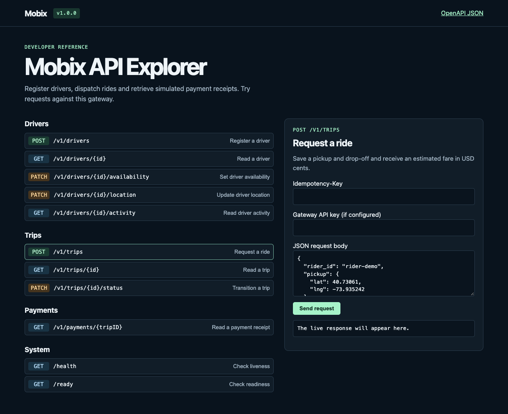

# Mobix

[English](README.md) · [Русский](README.ru.md)

[](https://github.com/bytepharaoh/Mobix/actions/workflows/ci.yml)
[](LICENSE)

Mobix is a Go backend for ride dispatch. It separates account access, trip management, driver matching, and payments into small services behind a single HTTP gateway.

The project focuses on the failure cases that matter in a distributed system: concurrent driver offers, idempotent transitions, authenticated real-time streams, shared rate limits, at-least-once message delivery, and repeatable deployments.

> Payments are simulated. Mobix does not connect to a payment provider or process real money.

## Services

| Service | Responsibility |
| --- | --- |
| Gateway | Authentication, authorization, routing, distributed rate limits, and SSE connections |
| Trip | Trip lifecycle, fare calculation, driver dispatch, and domain events |
| Driver | Driver availability, location updates, and offer decisions |
| Payment | Idempotent payment records and receipts for completed trips |

MongoDB stores application state. Redis holds distributed rate-limit counters. RabbitMQ distributes trip events between service replicas. External clients use the gateway's HTTP API; service-to-service calls carry short-lived signed identities.


## Trip flow

1. A rider creates a trip through the gateway.
2. Trip finds nearby drivers with recent location updates.
3. The closest eligible drivers receive a concurrent, expiring offer batch.
4. The first valid acceptance assigns the trip; late and duplicate decisions are rejected safely.
5. RabbitMQ fans versioned changes out to every gateway replica and authorized SSE client.
6. Trip completion creates one simulated payment record and receipt.

Real-time endpoints:

- `GET /v1/trips/{id}/events` for the rider, assigned driver, and operators
- `GET /v1/drivers/me/offers/events` for a driver's offer inbox

Streams begin with a current-state snapshot, support `Last-Event-ID`, send heartbeats, suppress duplicate versions, and disconnect slow or over-limit clients.


## Run locally

Requirements: Docker with Compose, GNU Make, and `curl`.

```bash
cp .env.example .env
make up
```

The gateway listens on `http://127.0.0.1:8080`. The interactive API reference is available at [http://127.0.0.1:8080/docs](http://127.0.0.1:8080/docs).

Run the included acceptance scenarios after the stack becomes healthy:

```bash
make demo
make dispatch-demo
make realtime-demo
make rate-limit-demo
make verify
```

Stop the stack with `make down`. Docker volumes are retained. Values in `.env.example` are for local development only; replace all credentials and signing secrets before using a shared environment.

## Public container images

The four services are published to GitHub Container Registry as multi-architecture images:

```bash
docker pull ghcr.io/bytepharaoh/mobix:gateway
docker pull ghcr.io/bytepharaoh/mobix:trip
docker pull ghcr.io/bytepharaoh/mobix:driver
docker pull ghcr.io/bytepharaoh/mobix:payment
```

Run the stack from the registry without building the Go services locally:

```bash
cp .env.example .env
make up-public
```

The service tags track `main`. Each publication also creates an immutable `<service>-sha-<commit>` tag. A Git tag such as `v1.2.0` creates `<service>-v1.2.0`. Images support `linux/amd64` and `linux/arm64` and include build provenance and an SBOM.

## API

The OpenAPI contract is stored at [`api/openapi/mobix.json`](api/openapi/mobix.json). It documents authentication, role permissions, trip and driver operations, errors, rate-limit responses, and SSE streams.



## Verification

```bash
make check       # formatting and go vet
make build       # compile all four services
make test-unit   # short test suite with the race detector
make test        # complete suite; Docker is required
```

CI also runs repository integration tests, Compose acceptance scenarios, broker recovery checks, Redis quota tests, and Kubernetes manifest rendering.

## Kubernetes

The manifests use Kustomize:

```bash
kubectl kustomize deployments/k8s/base
kubectl kustomize deployments/k8s/demo
```

`deployments/k8s/demo` is a self-contained evaluation environment. A production deployment should use durable managed or clustered data services, external secret management, TLS, backups, monitoring, and an ingress configured for long-lived SSE connections.


## Design notes

- MongoDB is the source of truth; RabbitMQ consumers tolerate redelivery.
- Trip transitions, payment creation, and retry keys are idempotent.
- A transactional outbox keeps trip state and published events consistent.
- Redis rate limits are shared across gateway replicas and use separate policies per operation.
- Dispatch offers rides to bounded groups of nearby drivers instead of contacting candidates one at a time.
- SSE fan-out works across gateway replicas and enforces global and per-account connection limits.
- Internal calls currently use HTTP. gRPC remains a documented roadmap option, not an implemented feature.

## License

Released under the [MIT License](LICENSE).
