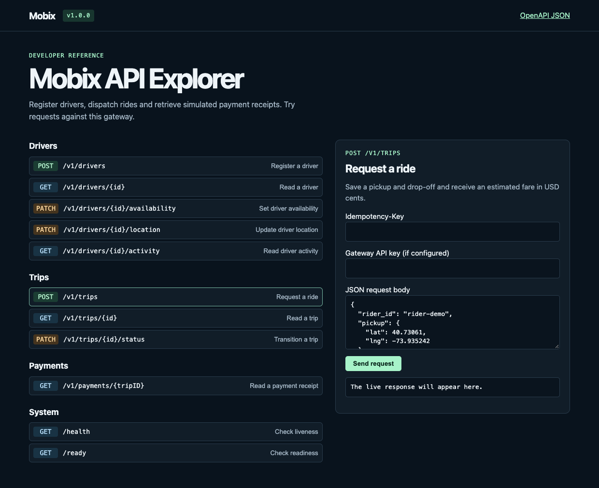
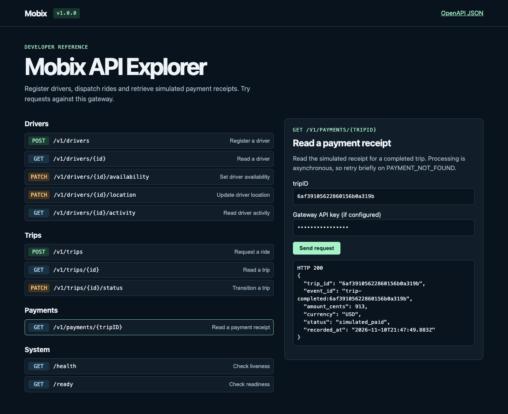

# Mobix

Mobix is a Go backend for a ride-sharing workflow with individual rider, driver, and operator accounts. Register a driver, request a ride, and follow it from nearby driver offers through completion. Redis enforces distributed gateway quotas. RabbitMQ carries versioned ride notifications and delivers completed rides to the payment service, which records a simulated receipt.

## Quick start

Install Docker with Compose v2, Bash, `make`, `curl`, and `jq`. Run these commands from your clone.

```sh
cp .env.example .env
make up
make dispatch-demo
```

Open the [API explorer](http://127.0.0.1:8080/docs) and use **Sign in** with the development operator credentials from `.env.example`. A successful sign-in sets the explorer's access token for subsequent requests. The operator can provision accounts, and each rider and driver signs in with their own credentials. The dispatch demo provisions a rider and four drivers. It verifies that three offers expire together, rejects a late acceptance, and completes the ride with the next nearest driver. `make demo` walks through the operator assignment flow.

The Compose gateway binds to `127.0.0.1`. Set these variables to use another port.

```sh
export GATEWAY_PORT=18080
export MOBIX_URL=http://127.0.0.1:18080
make up
make dispatch-demo
```

Compose reads the configuration in [`.env.example`](.env.example) through your local `.env` file. The scripts read `MOBIX_URL` and the operator credentials from your shell. When you customize the operator account, export `MOBIX_OPERATOR_EMAIL` and `MOBIX_OPERATOR_PASSWORD` before running `make demo` or `make verify`. Run `make logs` to follow service logs and `make down` to stop the stack while keeping its volumes.

## Accounts and permissions

An initial operator is created when the gateway starts with `MOBIX_BOOTSTRAP_EMAIL` and `MOBIX_BOOTSTRAP_PASSWORD`. Existing accounts and passwords are preserved across restarts. Operators provision accounts with `POST /v1/accounts`. Passwords use bcrypt, and the database stores a SHA-256 digest of each random session token. Sessions expire after 12 hours, and signing out revokes the current session immediately at the gateway.

| Endpoint | Purpose |
| --- | --- |
| `POST /v1/auth/login` | Exchange email and password for an access token. |
| `GET /v1/auth/me` | Read the signed-in account. |
| `POST /v1/auth/logout` | Revoke the current access token. |
| `POST /v1/accounts` | Provision a rider, driver, or operator account as an operator. |

Send `Authorization: Bearer <access_token>` on protected requests. The [OpenAPI contract](api/openapi/mobix.json), also served at `/openapi.json`, includes the request bodies and examples.

| Action | Rider | Driver | Operator |
| --- | --- | --- | --- |
| Create a trip | Own account | — | — |
| Read a trip | Own trip | Assigned trip | Any trip |
| Accept or decline an offer | — | Own open offer | — |
| Assign a driver manually | — | — | Allowed |
| Start or complete a trip | — | Assigned driver | — |
| Cancel before the trip starts | Own trip | — | Any trip |
| Register or update a driver profile | — | Own profile | — |
| Read a driver profile or activity | — | Own profile | Any profile |
| Read a payment receipt | Own trip | — | Any trip |

The gateway resolves the session identity and creates a short-lived service-specific signed assertion. Backend services verify the assertion and enforce their resource permissions. Trip obtains dispatch information through an authenticated internal driver endpoint. Payment checks access through Trip before returning a receipt.

## Distributed rate limits

Every gateway replica uses the same Redis token buckets. The atomic Lua check uses Redis server time, so concurrent replicas cannot overspend a bucket or drift because their clocks differ. Redis keys contain HMAC-SHA-256 subjects rather than raw account IDs, email addresses, or IP addresses. A `429 Too Many Requests` response includes `Retry-After` in seconds.

| Gateway policy | Default | Subject |
| --- | --- | --- |
| Login IP | `10/1m` | Client IP |
| Login account | `5/15m` | Normalized email, including unknown accounts |
| Ride request | `20/1m` | Authenticated account |
| Driver location | `120/1m` | Authenticated account |
| Offer inbox polling | `120/1m` | Authenticated account |
| Offer accept or decline | `30/1m` | Authenticated account |
| Event-stream connection | `30/1m` | Authenticated account |

Each policy has a separate bucket. Exhausting offer polling therefore does not prevent a driver from accepting an open offer. Override the defaults with the `RATE_LIMIT_*` values in [`.env.example`](.env.example). Use a random value of at least 32 bytes for `RATE_LIMIT_KEY_SECRET`; rotating it resets and re-keys the buckets.

The gateway does not trust `X-Forwarded-For` from direct clients. Set `TRUSTED_PROXY_CIDRS` to the comma-separated address ranges of the ingress hops that overwrite that header. The resolver removes trusted hops from right to left and uses the first untrusted address.

If Redis becomes unavailable, login returns `503 RATE_LIMIT_UNAVAILABLE` so an outage cannot disable brute-force protection. Authenticated, account-scoped policies fail open so active rides can continue, and the gateway periodically logs the policy and failure mode without flooding logs. Redis is intentionally excluded from `/ready`; an outage does not remove all gateway replicas. Run `make rate-limit-demo` to verify the `429` contract and both outage paths. The implementation follows Redis' [atomic token-bucket guidance](https://redis.io/docs/latest/develop/use-cases/rate-limiter/redis-py/).

## Ride lifecycle

| Step | Request | Result |
| --- | --- | --- |
| Register a driver | `POST /v1/drivers` | A signed-in driver creates one offline profile. Email, phone and license plate are unique. Use `GET /v1/drivers/me` to find your profile later. |
| Set availability | `PATCH /v1/drivers/{id}/availability` | Accepts `available` or `offline`. Use `PATCH /v1/drivers/{id}/location` to update coordinates. |
| Request a ride | `POST /v1/trips` | Uses the signed-in rider as the owner, stores pickup and drop-off, and returns an estimated fare in USD cents. An optional `Idempotency-Key` makes create retries safe. |
| Manual dispatch | `PATCH /v1/trips/{id}/status` | The operator sends `{"status":"assigned","driver_id":"<id>"}`. The driver must be available and can have one active ride. |
| Start and complete | `PATCH /v1/trips/{id}/status` | The assigned driver sends `{"status":"in_progress"}` and then `{"status":"completed"}`. A requested or assigned ride can also be cancelled. |
| View driver activity | `GET /v1/drivers/{id}/activity` | Returns effective status, an active trip ID when present, and completed trip count. |
| Read the receipt | `GET /v1/payments/{tripID}` | Returns the simulated payment. Retry briefly on `PAYMENT_NOT_FOUND` after completion. |

Use `GET /v1/trips/{id}` to inspect a ride at any step. Trip creation retry keys are scoped to the signed-in rider. Different riders can use the same key independently. Retrying with the same key and trip details returns the existing trip in its current state. Reusing a key with different details returns HTTP 409. Repeating a transition with the same target state returns the current trip while it is still in that state.

## Automatic dispatch

A new ride starts a background search for available drivers within 8 km of the pickup. The driver service ranks candidates using its MongoDB `2dsphere` index. The matcher skips drivers whose last location report is older than 90 seconds, who already have an active ride, or who already received an offer for this trip. Drivers with older profiles become eligible after reporting a fresh location. [MongoDB geospatial search](https://www.mongodb.com/docs/manual/reference/operator/aggregation/geonear/)

| Driver endpoint | What it does |
| --- | --- |
| `GET /v1/drivers/me/offers` | Poll for up to 50 open offers belonging to the signed-in driver. |
| `POST /v1/trips/{id}/offers/{offerID}/accept` | Accept an open offer. The first valid acceptance assigns the trip. |
| `POST /v1/trips/{id}/offers/{offerID}/decline` | Decline an open offer. The remaining drivers can still accept. |

The three closest eligible drivers get offers with the same deadline. If all decline, or if the deadline passes, the matcher moves to the next nearest drivers. An acceptance checks the current offer and expiry in the same MongoDB write that assigns the driver. A unique index allows one active ride per driver. If that index rejects an acceptance, the other offers on the ride stay open. Assignment or rider cancellation closes outstanding offers. The driver inbox removes closed offers, and late acceptances get HTTP 409. [MongoDB conditional writes and uniqueness](https://www.mongodb.com/docs/manual/core/write-operations-atomicity/)

Matching runs for up to two minutes with a maximum of 200 offers per trip. Trips without a match stay requested so the rider can cancel or an operator can assign a driver. The matcher retries briefly when no eligible driver is available or Driver is temporarily unavailable.

| Trip service setting | Default | Purpose |
| --- | --- | --- |
| `DISPATCH_BATCH_SIZE` | `3` | Maximum drivers invited at once, from 1 to 10 |
| `DISPATCH_RADIUS_METERS` | `8000` | Search radius, from 1 to 50,000 meters |
| `DISPATCH_LOCATION_MAX_AGE` | `90s` | Maximum age of a driver location report |
| `DISPATCH_OFFER_TTL` | `15s` | Time each batch stays open |

Run `make dispatch-demo` on the local demo stack with the default batch size. The script seeds four drivers near a test pickup and leaves them offline after the run.

## Versioned ride events

Every client-visible trip or offer change advances the trip's monotonic `version`. The same MongoDB write appends a stable event such as `trip.created`, `offers.updated`, `trip.status_changed`, or `matching.exhausted` to that trip's outbox. This keeps the canonical trip state and its notification inseparable, without requiring a distributed transaction.

The trip worker publishes these notifications to the durable `mobix.ride.events.v1` topic exchange using the event type as the routing key. It removes an outbox entry only after RabbitMQ confirms the mandatory, persistent publish. A reconnect can therefore publish a message more than once, but the stable `ride-event:<trip-id>:<version>` ID and monotonic version make downstream deduplication deterministic. Events contain audience account IDs, status, and version—not pickup or drop-off coordinates or a duplicate copy of trip state.

The exchange also feeds a bounded diagnostic queue, `mobix.realtime.ride-events.v1.buffer`, which retains at most 10,000 notifications for up to 10 minutes. Each gateway replica owns an exclusive RabbitMQ queue, so every replica receives every notification and can serve its local connections without database polling.

### Real-time streams

`GET /v1/trips/{id}/events` streams one authorized trip to its rider, assigned driver, or an operator. `GET /v1/drivers/me/offers/events` streams offer-inbox changes to the signed-in driver. Both endpoints use Server-Sent Events and require the normal bearer token; browser clients should use streaming `fetch` or an EventSource implementation that can set the `Authorization` header rather than putting tokens in query strings.

Each connection subscribes before fetching its initial state, then receives a `snapshot` event followed by notifications with newer versions only. `Last-Event-ID` is accepted on reconnect, stable event IDs suppress duplicates, heartbeat comments keep idle connections alive, and a fresh snapshot repairs any gap after a broker reconnect. Audience account IDs used inside the gateway are removed from client events.

Every replica limits total connections, connections per account, subscriber buffer size, write time, heartbeat interval, and connection lifetime. Repeated connection attempts also use the shared Redis quota. A full buffer or blocked write disconnects that client instead of slowing broker consumption. Configure these safeguards with the `SSE_*` and `RATE_LIMIT_EVENT_STREAM` values in [`.env.example`](.env.example).

## Screenshots

The original operator demo’s API explorer and simulated receipt. The current explorer opens on the sign-in form.





## How the services work together

The **gateway** exposes the HTTP API and shares rate-limit state through Redis. **Driver** manages registration, declared availability and location. **Trip** owns dispatch, the fare estimate, the state machine, versioned ride notifications, and driver activity derived from trip history. **Payment** consumes completion events and writes receipts to its own MongoDB database.


*The gateway authenticates account sessions and delegates signed identities to the services over HTTP. RabbitMQ carries trip completion events to Payment and versioned ride-change notifications for real-time delivery. The driver records shown in the diagram live in the `driver` collection.*

Trip state changes use a conditional MongoDB update. A partial unique index allows a driver to appear on one assigned or in-progress trip at a time. The driver service supplies the availability snapshot used during dispatch. Going offline opts out of future dispatch checks while an existing assignment remains active. Fare estimates use straight-line distance, a $3.50 base fare, and $1.20 per kilometer, rounded to cents.

Completing a trip writes its payment event into the trip document atomically. Every visible ride change uses the same outbox pattern for its versioned notification. A publisher removes a pending event only after RabbitMQ confirms routing. During a broker outage events stay in MongoDB, including across trip-service restarts. Delivery is at least once; stable ride-event IDs support deduplication, and MongoDB enforces one receipt per trip. The payment consumer acknowledges after recording a receipt and sends malformed messages to the dead-letter queue.


*The sequence uses illustrative endpoint labels. In Mobix, `POST /v1/trips` creates the ride and `PATCH /v1/trips/{id}/status` handles assignment, start, and completion. Trip checks availability through `GET /internal/drivers/{id}/dispatch-profile`. The gateway sends `GET /v1/payments/{tripID}` to Payment for the `simulated_paid` receipt.*

`GET /health` checks process liveness. `GET /ready` checks the backend HTTP services and their MongoDB connections. RabbitMQ or Redis outages do not make the gateway unready: the broker can delay receipts and ride notifications, while Redis applies the documented split failure policy. Inspect structured gateway logs for `rate limit backend unavailable`. Inspect trip and payment logs, `pending_payment` and `pending_ride_events` in MongoDB, and the RabbitMQ queues `mobix.payment.trip-completed.v1`, its `.dead` counterpart, and `mobix.realtime.ride-events.v1.buffer` when investigating a backlog.

## Kubernetes

For a local demo, build the four app images with Docker Compose and load them into a local [kind](https://kind.sigs.k8s.io/) cluster. Use a cluster with a default StorageClass for the MongoDB and RabbitMQ volumes.


*The local kind overlay runs two gateway replicas, the three backend services, and an ephemeral Redis limiter. MongoDB and RabbitMQ retain their persistent volumes. Kustomize generates the Secret from `mobix-dependencies`.*

```sh
docker compose build --provenance=false
kind create cluster --name mobix
kind load docker-image --name mobix \
  mobix/gateway:local mobix/driver:local mobix/trip:local mobix/payment:local
kubectl --context kind-mobix apply -k deployments/k8s/demo
kubectl --context kind-mobix -n mobix rollout status deployment/gateway --timeout=180s
kubectl --context kind-mobix -n mobix port-forward service/gateway 18081:8080
```

Run the demo in another terminal.

```sh
MOBIX_URL=http://127.0.0.1:18081 \
MOBIX_OPERATOR_EMAIL=operator@mobix.test \
MOBIX_OPERATOR_PASSWORD=mobix-demo-operator-password make dispatch-demo
```

For a deployment with external dependencies, use [the base manifests](deployments/k8s/base) in an environment-specific Kustomize overlay. Set the four images to immutable registry references and provide a `mobix-dependencies` Secret in the `mobix` namespace with the keys below.

| Keys | Values |
| --- | --- |
| `internal-signing-key` | At least 32 bytes shared by the gateway and backend services for delegated identities |
| `accounts-mongo-uri` | MongoDB connection string for the gateway account and session database |
| `redis-url` | Redis or `rediss` connection URL shared by every gateway replica. Use a managed highly available Redis service outside the demo. |
| `rate-limit-key` | Random value of at least 32 bytes used to HMAC rate-limit subjects |
| `bootstrap-email`, `bootstrap-password` | First operator credentials. Use a unique password of 12 to 72 UTF-8 bytes. |
| `trip-mongo-uri`, `driver-mongo-uri`, `payment-mongo-uri` | MongoDB connection strings. Give each service access to its own collections and required index operations. |
| `gateway-rabbitmq-url`, `trip-rabbitmq-url`, `payment-rabbitmq-url` | AMQP connection strings scoped to the Mobix exchange and queues with their required declaration, binding, publish, or consume permissions. |

The gateway Service is cluster-local. The internal HTTP and Redis ingress policies require a CNI that enforces NetworkPolicy. Use TLS and an identity-aware ingress for shared environments, configure its CIDRs as trusted proxies, and use encrypted `rediss://` connections when Redis leaves the cluster. The demo uses a single Redis pod without persistence; production should use managed replication and failover. The demo also uses single-node infrastructure and development credentials. Its MongoDB container lets glibc own rseq for compatibility with affected Linux kernels. Use unique operator credentials and independent random internal-signing and rate-limit keys in shared deployments. [MongoDB container compatibility notes](https://github.com/docker-library/mongo/issues/765)

## Upgrading from the operator demo

This release requires individual sessions on business endpoints. Trip creation accepts pickup and drop-off, and derives `rider_id` from the signed-in account. Set the internal signing key for all four services and configure the gateway account database before deploying the application containers together.

Operators retain read access to existing trips, driver records, and receipts. Rider and driver access depends on the account bindings stored by this release. Finish any active legacy rides before upgrading. To enroll an existing driver without duplicating their profile, provision a driver account, verify the link, and set `account_id` on that record in the `driver` collection through an administrative migration. Only link profiles whose `account_id` is absent. Existing payment events continue to be processed.

The new rider-scoped retry index uses a separate field. Old global retry keys remain attached to their legacy trips, and new requests use the authenticated rider's scope.

## Development and verification

Use Go 1.27.2 to match the container builder and GitHub Actions.

```sh
make check       # formatting and vet
make build       # compile the four services
make test-unit   # tests without Docker
make test        # race detector and MongoDB, Redis, and RabbitMQ Testcontainers tests
make dispatch-demo # automatic offer expiry, next-batch acceptance, and receipt
make realtime-demo # authenticated SSE snapshot and RabbitMQ-delivered update
make rate-limit-demo # 429 headers and Redis outage behavior
make verify        # HTTP authorization, concurrent assignment, and broker recovery
make k8s-render  # render the local Kubernetes overlay
```

Run `make verify` against a local test stack. It stops and restarts RabbitMQ and restarts the trip service while a payment event is pending. The verification script provisions two riders and two drivers, checks cross-account access and role permissions, and confirms recovery after a broker outage. Integration tests prove that two gateway replica queues receive the same ride event, while stream tests cover snapshots, authorization, privacy, version deduplication, broker resynchronization, connection limits, and slow-client cleanup. GitHub Actions runs these with the Redis multi-replica quota test, authorization and dispatch race suites, Compose demos, outage checks, and Kustomize rendering.

## Roadmap


*The proposed design adds Protocol Buffers contracts and unary gRPC for internal calls. Clients would continue to use REST through the gateway, and RabbitMQ would continue to carry trip completion events.*

## License

[MIT](LICENSE)
