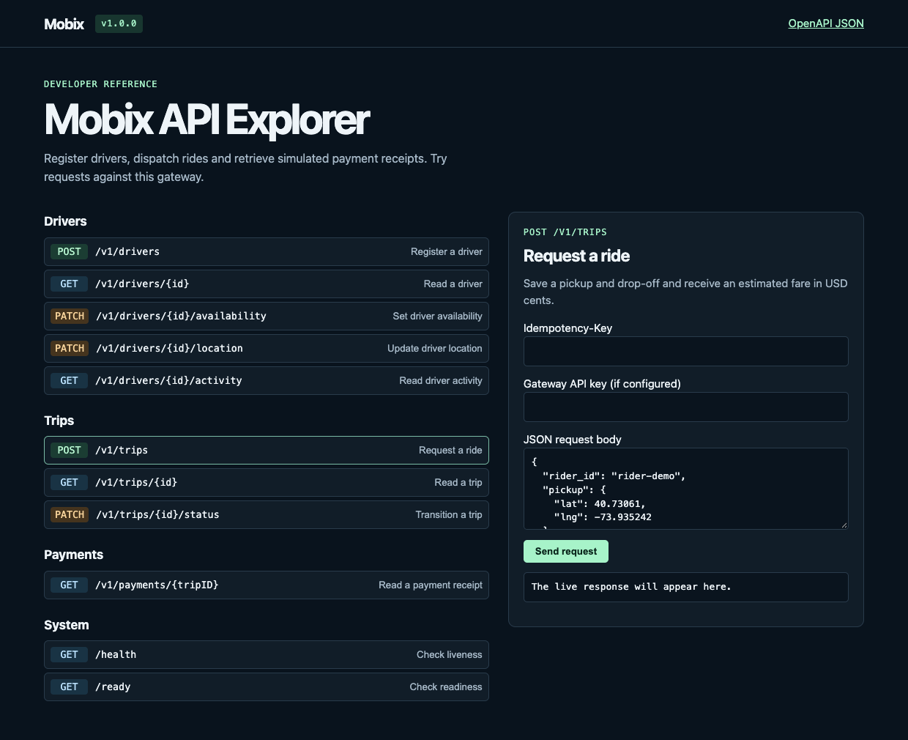

# Mobix

[English](README.md) · [Русский](README.ru.md)

[](https://github.com/bytepharaoh/Mobix/actions/workflows/ci.yml)
[](LICENSE)

Mobix — серверная часть сервиса заказа поездок, написанная на Go. Работа с аккаунтами, поездками, подбором водителей и платежами разделена между небольшими сервисами, доступными через единый HTTP gateway.

Основное внимание уделено задачам распределенной системы: конкурентным предложениям водителям, идемпотентным переходам состояния, авторизованным потокам событий, общим лимитам запросов, доставке сообщений и воспроизводимому развертыванию.

> Платежи имитируются. Mobix не подключен к платежному провайдеру и не обрабатывает реальные деньги.

## Сервисы

| Сервис | Ответственность |
| --- | --- |
| Gateway | Аутентификация, авторизация, маршрутизация, распределенные rate limits и SSE-соединения |
| Trip | Жизненный цикл поездки, расчет стоимости, подбор водителя и доменные события |
| Driver | Доступность и координаты водителя, обработка предложений |
| Payment | Идемпотентные записи о платежах и чеки завершенных поездок |

MongoDB хранит состояние приложения. Redis используется для распределенных счетчиков rate limit. RabbitMQ передает события между экземплярами сервисов. Внешние клиенты работают с HTTP API gateway, а межсервисные запросы содержат краткоживущую подписанную идентификацию.


## Как проходит поездка

1. Пассажир создает поездку через gateway.
2. Trip находит ближайших водителей с актуальными координатами.
3. Ограниченная группа подходящих водителей одновременно получает предложения со сроком действия.
4. Поездка назначается по первому корректному ответу; опоздавшие и повторные ответы безопасно отклоняются.
5. RabbitMQ передает версионированные изменения всем экземплярам gateway и авторизованным SSE-клиентам.
6. После завершения поездки создается одна запись об имитированном платеже и чек.

Потоки событий доступны по адресам:

- `GET /v1/trips/{id}/events` — для пассажира, назначенного водителя и операторов
- `GET /v1/drivers/me/offers/events` — для предложений конкретному водителю

Соединение начинается со снимка текущего состояния. Поддерживаются `Last-Event-ID`, heartbeat-сообщения, подавление повторных версий и отключение медленных клиентов.


## Локальный запуск

Понадобятся Docker с Compose, GNU Make и `curl`.

```bash
cp .env.example .env
make up
```

Gateway будет доступен по адресу `http://127.0.0.1:8080`, интерактивная документация API — по адресу [http://127.0.0.1:8080/docs](http://127.0.0.1:8080/docs).

После запуска можно выполнить готовые сценарии:

```bash
make demo
make dispatch-demo
make realtime-demo
make rate-limit-demo
make verify
```

Команда `make down` останавливает стек, сохраняя Docker volumes. Значения из `.env.example` предназначены только для локальной разработки; перед использованием общей среды замените учетные данные и секреты подписи.

## Публичные Docker-образы

Четыре сервиса публикуются в GitHub Container Registry как multi-architecture образы:

```bash
docker pull ghcr.io/bytepharaoh/mobix:gateway
docker pull ghcr.io/bytepharaoh/mobix:trip
docker pull ghcr.io/bytepharaoh/mobix:driver
docker pull ghcr.io/bytepharaoh/mobix:payment
```

Стек можно запустить из registry без локальной сборки Go-сервисов:

```bash
cp .env.example .env
make up-public
```

Теги сервисов отслеживают `main`. Каждая публикация также создает неизменяемый тег `<service>-sha-<commit>`. Git-тег вида `v1.2.0` создает `<service>-v1.2.0`. Образы поддерживают `linux/amd64` и `linux/arm64` и содержат build provenance и SBOM.

## API

Контракт OpenAPI находится в [`api/openapi/mobix.json`](api/openapi/mobix.json). Он описывает аутентификацию, роли, операции с поездками и водителями, ошибки, rate limits и SSE-потоки.



## Проверка

```bash
make check       # форматирование и go vet
make build       # сборка четырех сервисов
make test-unit   # короткие тесты с race detector
make test        # полный набор тестов; требуется Docker
```

CI дополнительно запускает интеграционные тесты репозиториев, Compose-сценарии, проверки восстановления RabbitMQ, тесты Redis-квот и рендеринг Kubernetes-манифестов.

## Kubernetes

Манифесты используют Kustomize:

```bash
kubectl kustomize deployments/k8s/base
kubectl kustomize deployments/k8s/demo
```

`deployments/k8s/demo` — автономная среда для оценки проекта. Для production необходимы отказоустойчивые хранилища и брокер, внешнее управление секретами, TLS, резервные копии, мониторинг и ingress с поддержкой долгоживущих SSE-соединений.


## Технические решения

- MongoDB является источником истины; RabbitMQ consumers допускают повторную доставку.
- Переходы поездки, создание платежа и ключи повторных запросов идемпотентны.
- Transactional outbox согласует состояние поездки и публикуемые события.
- Redis rate limits общие для всех экземпляров gateway и разделены по операциям.
- Dispatch отправляет предложения ограниченным группам ближайших водителей, а не по одному.
- SSE fan-out работает между экземплярами gateway и ограничивает соединения глобально и по аккаунту.
- Внутренние вызовы пока используют HTTP. gRPC остается вариантом roadmap, а не реализованной функцией.

## Лицензия

Проект распространяется по [лицензии MIT](LICENSE).
